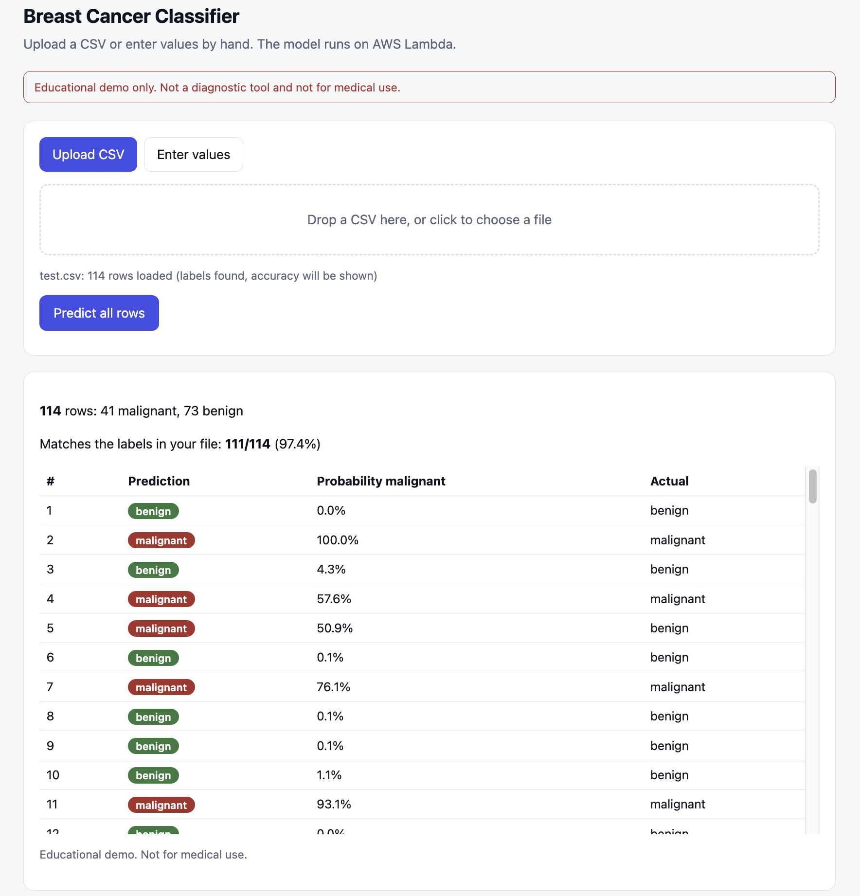
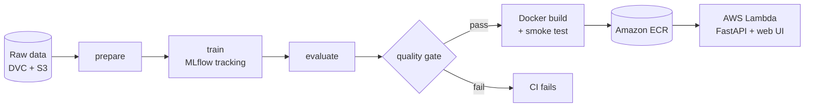
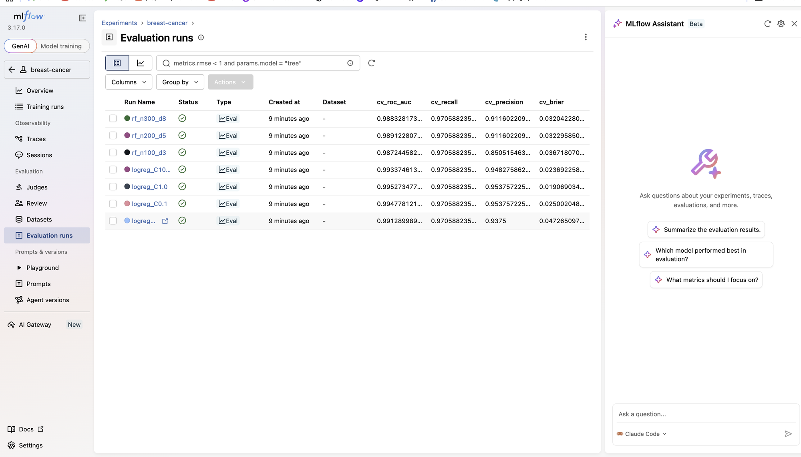
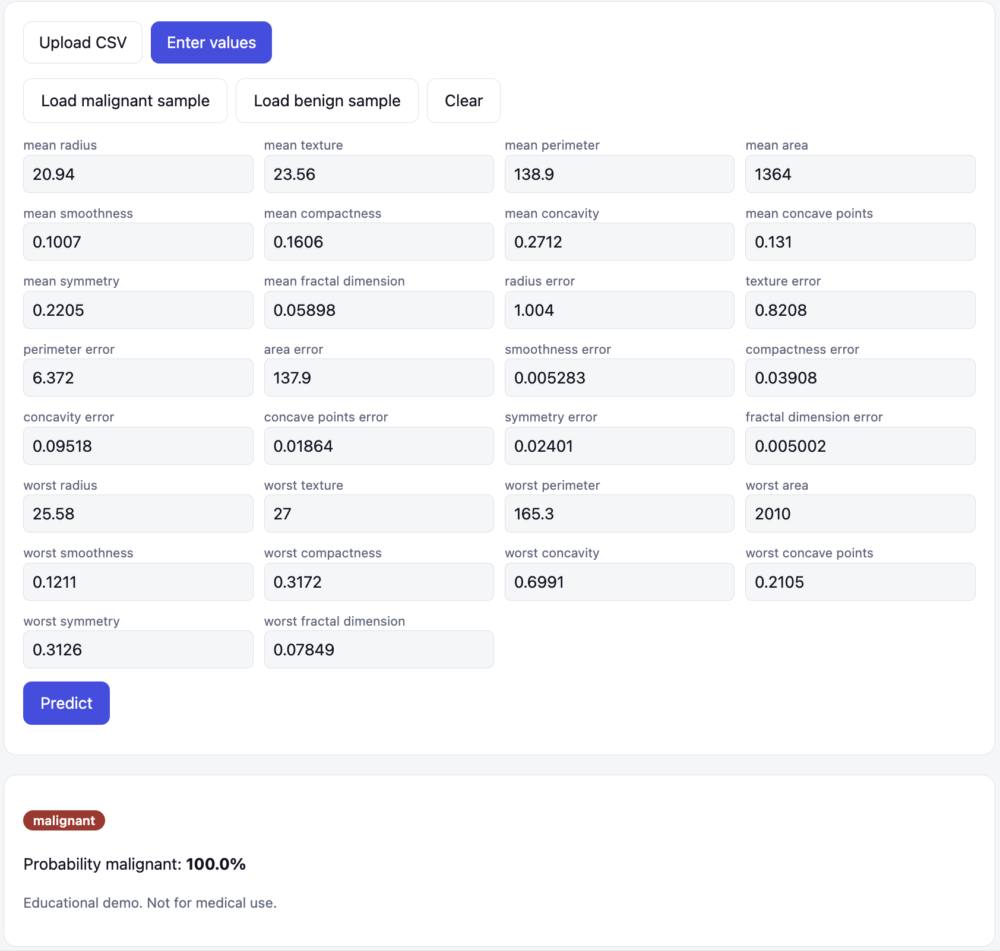
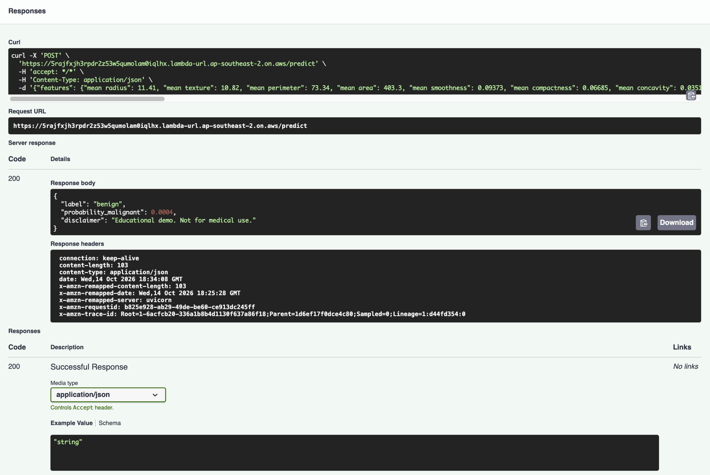

# Breast Cancer MLOps

An end-to-end MLOps pipeline around a breast-cancer classifier: versioned data, reproducible
training, experiment tracking, a quality gate, CI/CD, a containerised API with a web UI, and
deployment on AWS Lambda.

> **Educational project only. This is not a diagnostic tool and must not be used for medical decisions.**

**Deployment:** the API and web UI were deployed on AWS Lambda (container image from Amazon ECR, via a public
Function URL) and verified end to end; the screenshots below are from that deployment. The AWS resources have
since been torn down to avoid cost, so there is no live link. Everything can be redeployed from this repo
(see [Redeploy](#redeploy)).



## Architecture



| Stage | Tool |
|---|---|
| Data versioning | DVC (raw data was stored in an S3 remote during development; see note below) |
| Pipeline | `dvc.yaml`: prepare, train, evaluate |
| Experiment tracking | MLflow (local SQLite backend) |
| Model | scikit-learn: StandardScaler + logistic regression |
| Quality gate | `src/gate.py` against thresholds in `params.yaml` |
| API and UI | FastAPI, with a single-page web UI |
| Packaging | Docker |
| CI/CD | GitHub Actions, then Amazon ECR, then AWS Lambda (container image) |

## Results

Held-out test set: 114 rows (20% stratified split, seed 42). Malignant is the positive class.

| Metric | Value |
|---|---|
| Recall (malignant) | 0.976 |
| Precision (malignant) | 0.976 |
| ROC AUC | 0.997 |
| Brier score | 0.019 |
| False negatives / false positives | 1 / 1 |

The decision threshold is not 0.5. It is picked on out-of-fold cross-validation predictions as the highest
threshold that still reaches the target recall of 0.97, because missing a malignant case is the costlier error.
The CI gate fails the build if test recall drops below 0.95, precision below 0.90, or ROC AUC below 0.98.

### Experiment comparison

Seven configurations were compared with the same 5-fold CV on the training set (`src/sweep.py`).
At the fixed recall target, the differences show up in precision and calibration:

| Run | CV ROC AUC | CV recall | CV precision | CV Brier |
|---|---|---|---|---|
| **logreg, C=1.0 (deployed)** | **0.9953** | 0.971 | **0.954** | **0.0191** |
| logreg, C=0.1 | 0.9948 | 0.971 | 0.954 | 0.0250 |
| logreg, C=10 | 0.9934 | 0.971 | 0.948 | 0.0237 |
| logreg, C=0.01 | 0.9913 | 0.971 | 0.938 | 0.0473 |
| random forest, 200 trees, depth 5 | 0.9891 | 0.971 | 0.912 | 0.0323 |
| random forest, 300 trees, depth 8 | 0.9883 | 0.971 | 0.912 | 0.0320 |
| random forest, 100 trees, depth 3 | 0.9872 | 0.971 | 0.851 | 0.0367 |

A simple linear model beat the random forests on every measure here. Model selection used only the
training set; the test set was used once, for the numbers above.



## Try it

The web UI has two modes. Upload a CSV with the 30 feature columns to score many rows at once
(if the file has a label column, it also reports how many predictions match):


Or enter values by hand, with one-click malignant and benign samples:



The same model is available as a JSON API (`POST /predict`, `POST /predict_batch`, `GET /health`, `GET /features`):



```bash
curl -X POST "$URL/predict" -H "Content-Type: application/json" \
  -d '{"features": {"mean radius": 11.41, "...": 0}}'   # all 30 features are required
```

## Reproduce

```bash
git clone https://github.com/Pragyan127/Breast_Cancer_MLOps.git
cd Breast_Cancer_MLOps
python -m venv .venv && source .venv/bin/activate
pip install -r requirements.txt

python src/make_dataset.py # writes data/raw/wdbc.csv from scikit-learn (identical to the DVC-tracked file)
dvc repro                  # prepare -> train -> evaluate, writes models/ and metrics.json
python src/gate.py         # quality gate
pytest -q

python src/sweep.py        # optional: log the comparison runs to MLflow
mlflow ui --backend-store-uri sqlite:///mlflow.db --port 5001
```

Run the API locally with Docker (the image needs `models/`, so run `dvc repro` first):

```bash
docker build -t bc-api .
docker run -p 8000:8000 bc-api
curl localhost:8000/health
```

## CI/CD

On every push and pull request, GitHub Actions runs: install, `ruff`, `make_dataset.py`, `dvc repro`, the quality gate,
`pytest`, a Docker build, and a container smoke test (`/health`). A push to `main` that passes all of these then
builds the image, pushes it to Amazon ECR tagged with the commit hash, and updates the Lambda function
(only when the `DEPLOY_ENABLED` repository variable is `true`).
AWS credentials, needed only for the optional deploy, are stored as GitHub repository secrets.

## Data versioning note

During development the raw dataset was tracked with DVC and pushed to an Amazon S3 remote, and CI pulled it
from there. That bucket has since been deleted. The dataset ships with scikit-learn, so `src/make_dataset.py`
regenerates the exact same file (verified byte-for-byte against the DVC-tracked hash), and CI now uses it.
The `.dvc` files and `dvc.lock` stay in the repo, so `dvc repro` still verifies data integrity and only
re-runs stages whose inputs changed.

## Redeploy

The deploy steps in CI are switched off by default. To deploy again: create an ECR repository named `bc-api` and a
Lambda function `bc-api` (container image, x86_64, 1024 MB memory, 30 s timeout, Function URL with auth type `NONE`),
give the CI IAM user ECR push and Lambda update permissions, then set the GitHub repository variable
`DEPLOY_ENABLED` to `true`. The next push to `main` builds, pushes and deploys the image.

## Repository layout

```
app/            FastAPI app and web UI (index.html)
src/            prepare, train, evaluate, gate, sweep, monitor
tests/          API and pipeline tests
dvc.yaml        pipeline definition
params.yaml     hyperparameters and quality-gate thresholds
Dockerfile      serving image (also runs on Lambda via the Lambda Web Adapter)
.github/        CI/CD workflow
MODEL_CARD.md   intended use, data, metrics, limitations
```

## Drift monitoring

`src/monitor.py` compares the training features against new data with Evidently and exits non-zero when more than
30% of columns drift. It is included as a script; it has not been wired into a scheduled workflow yet.

<!-- TODO: add CI screenshots (green run and a deliberately failed gate) and the drift report screenshot -->

## Limitations

Only 569 samples from a single benchmark dataset (Wisconsin Diagnostic Breast Cancer), no external validation,
and predictions from the demo API are not stored durably. See [MODEL_CARD.md](MODEL_CARD.md).
